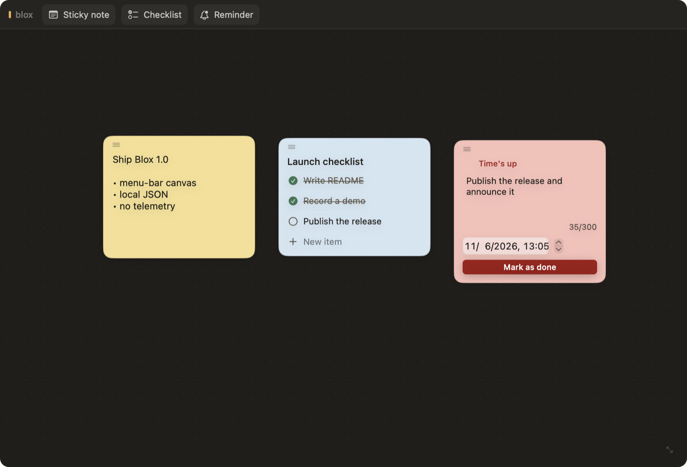

English | [简体中文](README.zh-CN.md)

# Blox

Blox is a lightweight macOS menu-bar canvas for sticky notes, checklists, and reminders.

Click the menu-bar icon to open a resizable canvas; right-click for Settings and Quit. Drop in a sticky note, build a quick checklist, or set a reminder that turns the icon red until you mark it done. Everything is stored locally as JSON — no accounts, no network, no telemetry.



## Features

- **Menu-bar first** — no Dock icon. Click to open or close; press and drag down from the icon to unroll the canvas.
- **Three card types**
  - Sticky notes with a free-form text editor.
  - Checklists with titles, add/remove items, and strikethrough for completed items.
  - Reminders with a due date and time, a 300-character body, and a status flow of pending → fired → done.
- **Reminder alerts** — the status-bar icon turns red while any reminder is overdue and clears once it is completed.
- **Room-to-breathe canvas** — a scrollable canvas with a faint dot grid. New cards are placed in free space instead of stacking on top of each other; drag a card by its grip to move it anywhere, or delete it from its context menu.
- **Resizable window** — drag the handle in the bottom-right corner. The window stays horizontally centered, stays pinned to the top of the screen, remembers its size between launches, and the canvas grows with it.
- **Local-first storage** — plain JSON on disk, with atomic writes and automatic backup of corrupted files.
- **Settings** — right-click the menu-bar icon for Settings and Quit. Pick the interface language (English or 简体中文) on the General tab; a hotkey setting is reserved for a future release. The About tab shows the version, license, and repository link.

## Requirements

- macOS 14 or later
- Swift 6 toolchain (Xcode or Command Line Tools)

## Install

Download `Blox-1.0.1.dmg` from Releases, open it, and drag **Blox** into Applications.

Blox is ad-hoc signed and not notarized. On first launch macOS may refuse to open it; right-click the app and choose **Open**, or run:

```sh
xattr -dr com.apple.quarantine /Applications/Blox.app
```

### Alfred

Double-click `alfred/Blox.alfredworkflow` to install the workflow, then type `b` and press Return to open the canvas.

## Build and run

Run from source:

```sh
swift run blox
```

Build an app bundle:

```sh
./scripts/build-app.sh
```

Build and install to `/Applications/Blox.app`:

```sh
./scripts/build-app.sh install
```

## Tests

```sh
swift run blox-selftest
```

The self-test covers reminder firing and persistence, text limits, corruption recovery, drag clamping, free-space placement, and window-size persistence.

## Data

Blox keeps its state in Application Support:

- `~/Library/Application Support/blox/blocks.json` — cards and their content
- `~/Library/Application Support/blox/window-size.json` — last window size

If `blocks.json` cannot be decoded, it is moved aside as `blocks-<timestamp>-<id>.corrupt.json` and the canvas starts empty rather than losing the file.

## Project layout

```
Sources/bloxKit      Models, store, and JSON storage (no UI)
Sources/blox         AppKit + SwiftUI menu-bar app
Sources/blox-selftest Assertions for the kit
scripts/build-app.sh Release build, bundle assembly, code signing, install
```

The canvas model (`Block`, `BlockKind`) is `Codable`, so cards are forward-compatible: unknown files fail closed and are backed up instead of overwritten.

## License

MIT © halfstring
