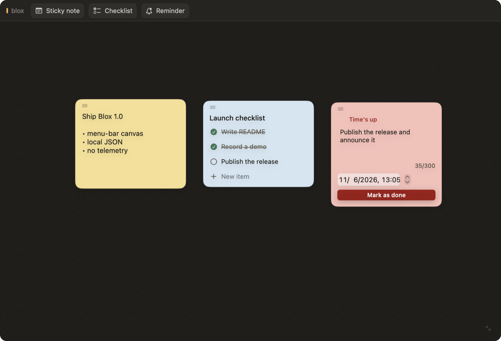

[English](README.md) | 简体中文

# Blox

Blox 是一个轻量的 macOS 菜单栏画布，用来放标签贴、清单和提醒。

点击菜单栏图标即可展开一块可缩放的画布；右键可以进入设置或退出。贴上一条标签贴、列一份快速清单，或设一个到点提醒——提醒过期后图标会变红，直到你把它标记完成。所有内容都以 JSON 保存在本地：没有账号、没有网络、没有遥测。



## 功能

- **菜单栏优先** —— 不占 Dock。点击打开/关闭；从图标按住向下拖可以“展开”画布。
- **三种卡片**
  - 标签贴：自由文本编辑。
  - 清单：标题、增删条目、完成项划线。
  - 提醒：到期日期与时间、300 字正文，状态为 待触发 → 已触发 → 已完成。
- **提醒提醒** —— 有提醒过期时菜单栏图标变红，标记完成后恢复。
- **有呼吸感的画布** —— 可滚动画布配淡淡的点阵底纹。新建卡片会落在空白处，不会互相叠压；拖动卡片顶部把手可移动，右键菜单可删除。
- **可缩放的窗口** —— 拖动右下角手柄缩放窗口。窗口始终水平居中、顶部贴住屏幕顶部，并记住尺寸；画布随窗口一起变大。
- **本地优先存储** —— 磁盘上的普通 JSON，原子写入；文件损坏时自动备份而不是直接丢失。
- **设置** —— 右键菜单栏图标打开设置：通用页可切换界面语言（English / 简体中文），热键项为后续版本预留；关于页显示版本、许可证与仓库链接。

## 环境要求

- macOS 14 或更高
- Swift 6 工具链（Xcode 或 Command Line Tools）

## 安装

从 Releases 下载 `Blox-1.0.0.dmg`，打开后把 **Blox** 拖入“应用程序”。

Blox 使用 ad-hoc 签名、未做公证。首次打开时 macOS 可能拦截，请右键点应用并选择**打开**，或执行：

```sh
xattr -dr com.apple.quarantine /Applications/Blox.app
```

## 构建与运行

从源码运行：

```sh
swift run blox
```

构建 app 包：

```sh
./scripts/build-app.sh
```

构建并安装到 `/Applications/Blox.app`：

```sh
./scripts/build-app.sh install
```

## 测试

```sh
swift run blox-selftest
```

自测覆盖：提醒触发与持久化、文本上限、损坏恢复、拖拽坐标钳制、空白处放置、窗口尺寸持久化。

## 数据

Blox 把状态保存在 Application Support：

- `~/Library/Application Support/blox/blocks.json` —— 卡片及其内容
- `~/Library/Application Support/blox/window-size.json` —— 上次窗口尺寸

如果 `blocks.json` 无法解码，它会被移到 `blocks-<时间戳>-<id>.corrupt.json`，画布以空状态启动，而不是直接丢掉文件。

## 项目结构

```
Sources/bloxKit      模型、状态与 JSON 存储（无 UI）
Sources/blox         AppKit + SwiftUI 菜单栏应用
Sources/blox-selftest 针对 bloxKit 的断言
scripts/build-app.sh 发布构建、组装 app 包、签名、安装
```

画布模型（`Block`、`BlockKind`）遵循 `Codable`，因此卡片数据向前兼容：遇到无法识别的文件会安全失败并备份，而不是覆盖原文件。

## 许可证

MIT © halfstring
